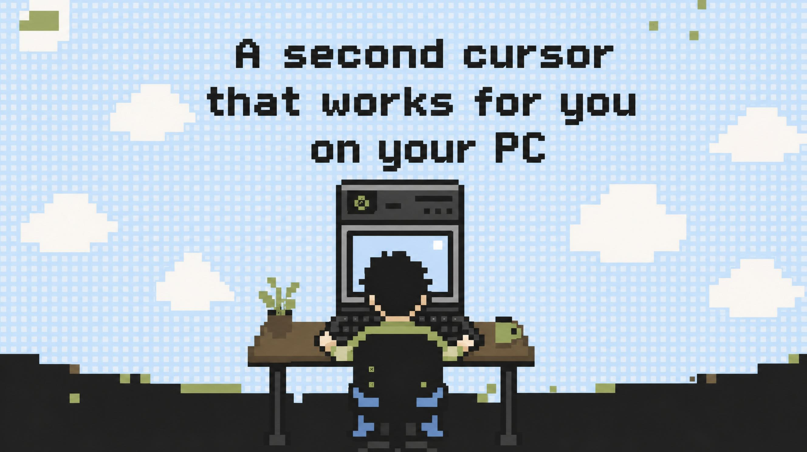
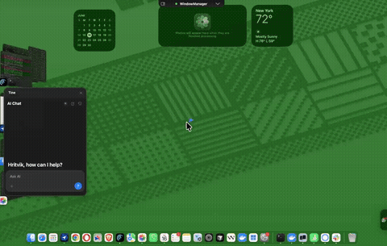
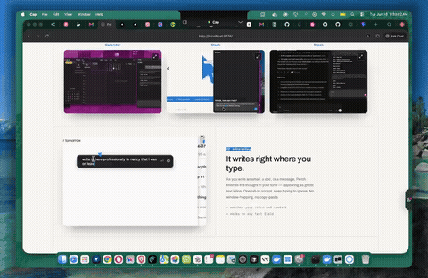
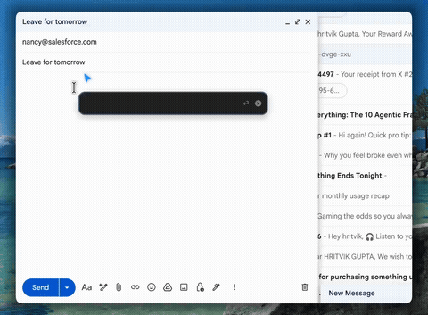
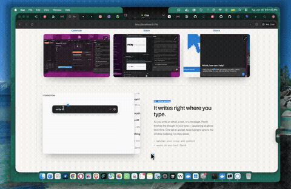
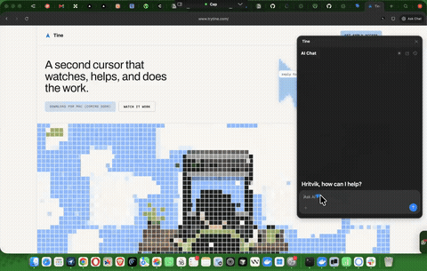
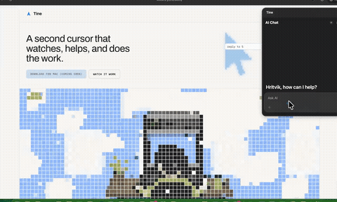
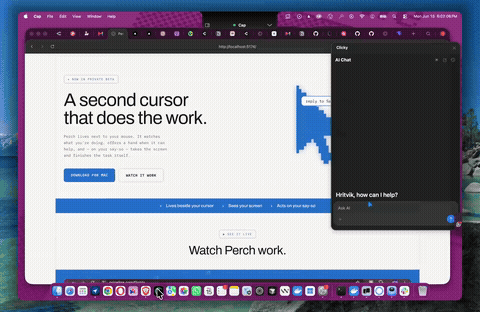
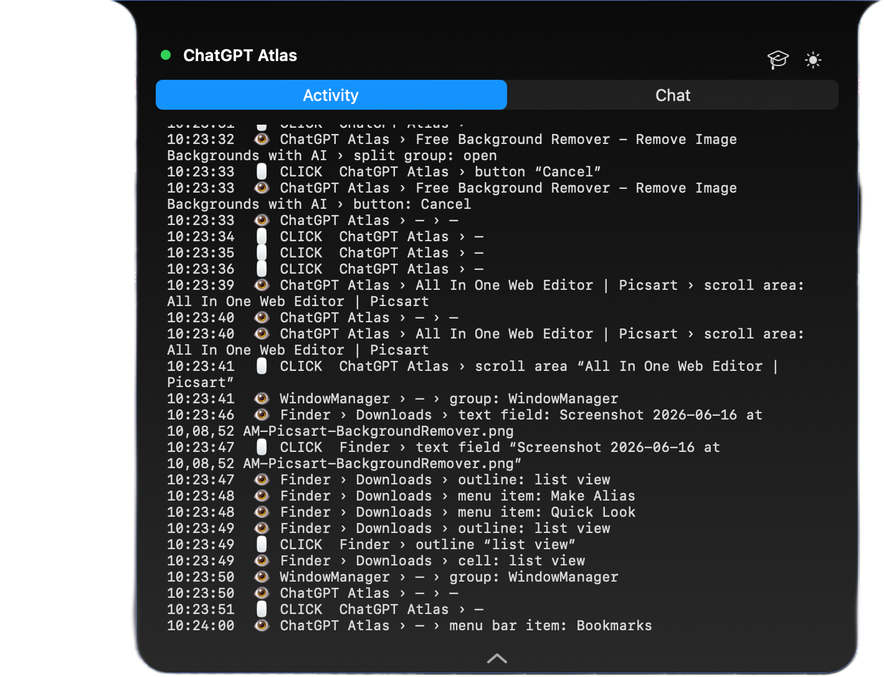
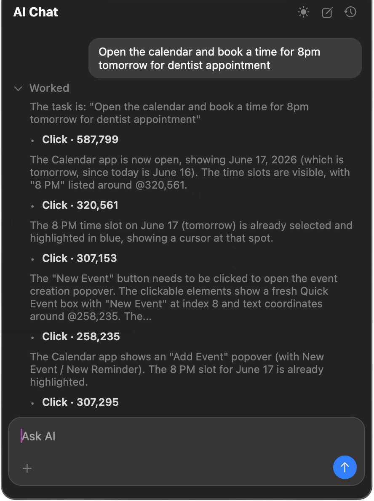

<div align="center">



# Tine

**A second cursor that watches your screen, suggests help, and — on your say-so — takes over and finishes the task.**

[](LICENSE)
[](macos-app)
[](macos-app/Package.swift)
[](CONTRIBUTING.md)

[Overview](#overview) • [Demo](#demo) • [Screenshots](#screenshots) • [How it works](#how-it-works) • [Getting started](#getting-started) • [Repo structure](#repo-structure) • [Roadmap](#roadmap) • [Contributing](#contributing)

</div>

---

## Overview

Tine lives beside your cursor as a lightweight macOS menu-bar app. It sees your screen the way you do, and works in three modes:

| Mode | What it does |
|---|---|
| **01 · Watch** | Reads the active app, your selection, and your recent moves — no prompts, no copy-paste, no context to re-explain. |
| **02 · Assist** | Offers a draft, a fill, a next step — right where you are. One keystroke to accept, one to wave it off. |
| **03 · Take over** | Hand it a goal and Tine drives the cursor itself — clicking through multi-step work while you watch. Grab the mouse to pause it instantly. |

**Core capabilities:**

- 🧠 **Reads your context** — watches the active app, your selection, and recent actions, so it always knows what you're trying to do.
- ✍️ **Drafts in place** — replies, messages, and docs written right where your cursor is.
- 📋 **Fills the busywork** — forms, fields, and the repetitive clicks, handled automatically.
- 🖱️ **Runs multi-step tasks** — give it a goal and it clicks all the way through, across apps, tabs, and screens.
- 🔁 **Learns your patterns** — adapts to how you actually work, and stays on your machine.
- 🛑 **Hands control back** — pause, correct, or take the wheel anytime; touch the mouse and Tine steps aside.

## Demo

<div align="center">



*Full-resolution version: [`public/perch-demo.mp4`](public/perch-demo.mp4)*

</div>

### More demos

| Island mode | Inline mode | Teach mode |
|---|---|---|
|  |  |  |
| Notch-native activity feed that shows what Tine is watching and doing. | Summon Tine at your text cursor (`⌃⌥K`) to draft or fix text in place. | Show Tine a workflow once — it picks up the pattern for next time. |

**Real tasks, start to finish:**

| Task 1 | Task 2 | Task 3 |
|---|---|---|
|  |  |  |
| Booking a calendar slot end-to-end. | A multi-step web task. | A multi-app task. |

Full-resolution `.mp4` versions of every clip above are in [`public/`](public), if you'd rather watch at native quality/audio.

## Screenshots

<div align="center">
<table>
<tr>
<td align="center" width="33%"><br><sub><b>Activity feed</b> — the notch-native island narrates every click and read Tine makes, live.</sub></td>
<td align="center" width="33%"><br><sub><b>Collapsed state</b> — stays out of the way until you need it.</sub></td>
<td align="center" width="33%"><br><sub><b>AI chat</b> — hand it a goal in plain English and watch it work.</sub></td>
</tr>
</table>
</div>

## How it works

The macOS app (codename **ClickyMine**, under [`macos-app/`](macos-app)) runs a native ReAct agent loop — reason → tool call → observe → repeat — driven by a vision-capable LLM over OpenRouter:

```
Sources/ClickyMine/
├── App/        App shell & orchestration (entry point)
│   └── main.swift          Menu-bar app, global hotkey, window wiring, agent runners
├── Agent/      Core business logic (the "brain")
│   ├── Agent.swift         Native ReAct loop: reason → tool → observe → repeat
│   ├── ChatStore.swift     Conversation state + history
│   └── Skill.swift         Taught/learned workflow patterns
├── Libs/       External integrations
│   └── Claude.swift        OpenRouter LLM client (chat completions, vision)
├── System/     macOS platform wrappers (Accessibility, input, capture, speech)
│   ├── Inspector.swift     AXUIElement: clickable elements, focused field, hit-testing
│   ├── Clicker.swift       Synthetic CGEvent input: click, type, hotkey, scroll
│   ├── ScreenCapture.swift Main-display screenshot → resize → base64 JPEG
│   ├── RecordMode.swift    Teach-by-demonstration recording
│   ├── OCR.swift           On-screen text recognition
│   └── Voice.swift         Speech recognition (STT)
└── UI/         Presentation layer
    ├── Island.swift        Notch-native Dynamic Island (activity feed)
    ├── Panes.swift         Activity + Chat panes
    ├── Sidebar.swift       Floating, draggable Copilot-style chat sidebar
    ├── Overlay.swift       Transparent, click-through companion cursor
    └── Theme.swift         Light / dark theme
```

An optional Python **grounding server** ([`grounding-server/`](grounding-server)) runs the GTA1 grounding algorithm as a FastAPI service — given a screenshot and an instruction like *"the hour digits of the start time"*, it returns the `(x, y)` to click. This is used when pixel-precise pointing needs a dedicated vision model instead of the general-purpose chat model.

The marketing site ([`src/`](src), served from [`public/`](public)) is a static Vite + React landing page — it's how people find and install Tine, not part of the app runtime.

## Getting started

### Prerequisites
- macOS 13+
- [Swift 6 toolchain](https://www.swift.org/install/) (ships with recent Xcode)
- An [OpenRouter](https://openrouter.ai/) API key (Tine talks to models through OpenRouter, including Claude)

### Run the macOS app

```bash
git clone https://github.com/aayush-wiz/trytine.git
cd trytine/macos-app

export OPENROUTER_API_KEY=sk-or-...
swift run
```

On first launch, macOS will ask for **Screen Recording** and **Accessibility** permissions (System Settings → Privacy & Security). Grant both, then relaunch.

Once running, Tine sits in the menu bar (▲):

| Shortcut | Action |
|---|---|
| `⌃⌥Space` | Ask Tine a question / give it a task (voice or typed) |
| `⌃⌥K` | Inline edit at your text cursor |
| `⌃⌥S` | Stop the currently running task |

#### Configuration

| Env var | Default | Purpose |
|---|---|---|
| `OPENROUTER_API_KEY` | *(required)* | Auth for all LLM calls |
| `LLM_MODEL` | `deepseek/deepseek-chat` | Model used for the main agent loop |
| `LLM_MODEL_INLINE` | `$LLM_MODEL` | Model used for inline edits |
| `CU_MODEL` | `$LLM_MODEL` | Model used for computer-use / clicking steps |
| `CU_OPENROUTER` | — | Route computer-use calls through OpenRouter's computer-use tool format |
| `OPENROUTER_BASE_URL` | `https://openrouter.ai/api/v1` | Override for self-hosted/proxy setups |

### Run the grounding server (optional)

```bash
cd grounding-server
pip install -r requirements.txt
export OPENROUTER_API_KEY=sk-or-...
./run.sh
```

### Run the landing page (optional)

```bash
npm install
npm run dev        # local dev server
npm run build      # type-check + production build to dist/
```

A no-build single-file version also exists at [`js/index.html`](js/index.html) — open it directly in a browser.

## Repo structure

```
trytine/
├── macos-app/          Swift Package — the actual Tine app (menu bar, agent, overlay UI)
├── grounding-server/    Python/FastAPI — optional pixel-grounding microservice
├── src/                 React/TypeScript — marketing landing page
├── js/                  Same landing page, single-file/no-build version
├── public/              Images, demo videos, static assets for the landing page
└── Dockerfile, fly.toml, nginx.conf   Landing-page deployment (Fly.io)
```

## Roadmap

- [ ] **Voice input** — swap the text prompt for push-to-talk speech recognition end-to-end.
- [ ] **Real clicking (agent mode)** — fire synthetic clicks at the same coordinates the overlay points to.
- [ ] **Accessibility-first targeting** — prefer `AXUIElement` named-element clicks over raw pixel coordinates.
- [ ] **Streaming** — stream LLM + TTS output so responses feel instant.

## Contributing

Contributions are welcome — see [CONTRIBUTING.md](CONTRIBUTING.md) for dev setup, project layout, and the PR process.

## License

[PolyForm Noncommercial License 1.0.0](LICENSE) — free to use, study, modify, and share for **noncommercial purposes only**. Commercial use, including reselling or offering Tine (or a derivative) as a paid product/service, is not licensed under these terms — reach out if you want a commercial license.
